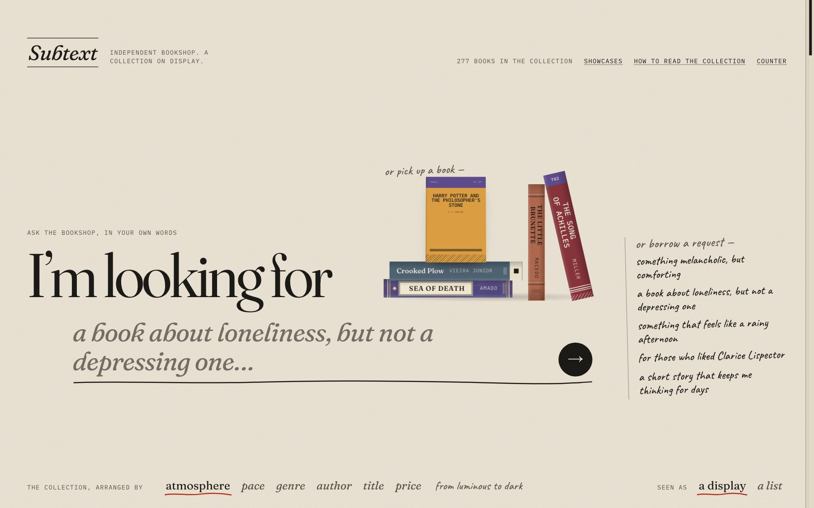
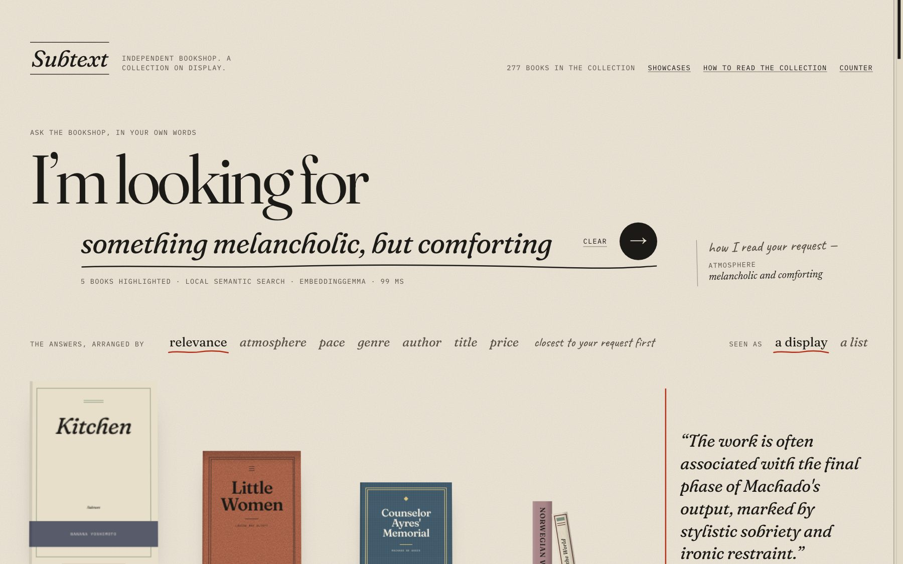
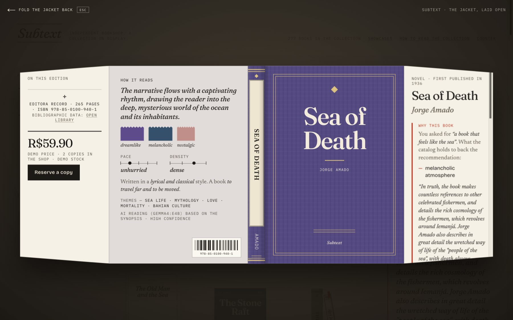
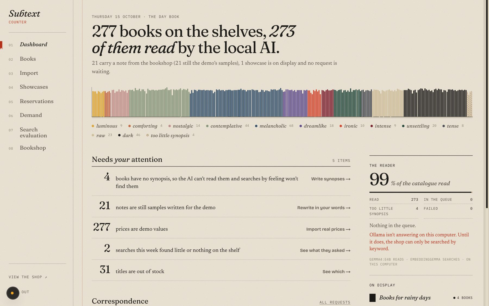
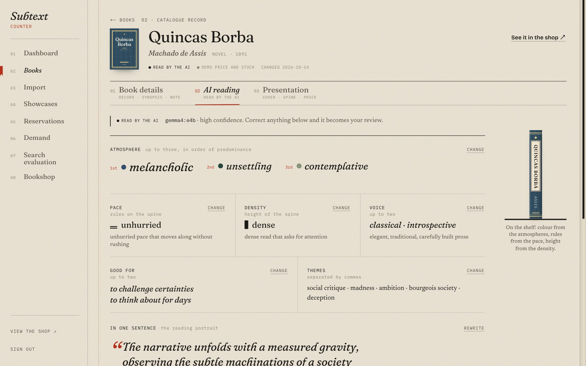
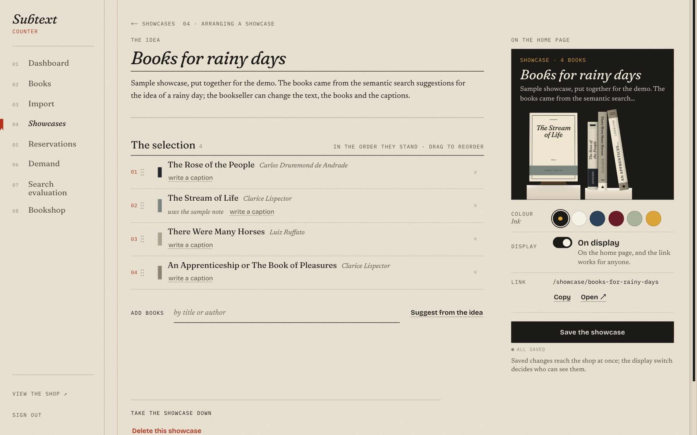
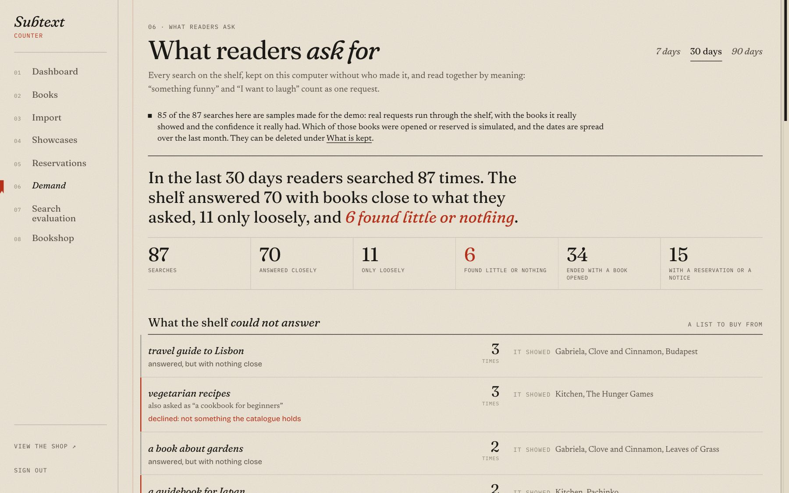
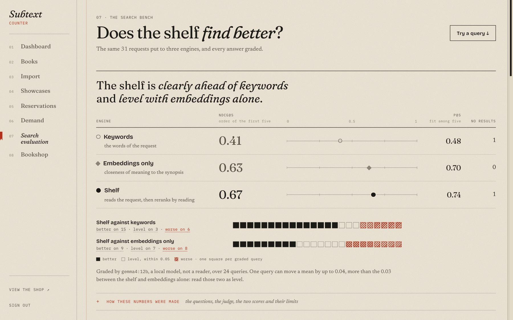

# Subtext

A shelf that understands what readers want to feel, for independent bookshops. Open models, running in the shop.



An independent bookshop sells by conversation: “something sad, but not too sad”, “like that one I read last summer”. Online, its catalogue is a list searched by title. The reader who doesn’t know the title leaves, and the bookshop never learns what they were looking for.

Subtext puts the shop’s collection on display and lets readers ask for it in their own words. A local model reads every synopsis once; the shelf then answers requests by meaning, shows its reasons, says when nothing fits, and keeps what readers asked for, without who asked, so the bookshop knows what to stock.

## What it does

**For readers, the collection on display.**

- Ask in your own words: “something melancholic, but comforting”, “a book that feels like the sea”, “for those who liked Clarice Lispector”. The closest books step out of their niches, and the margin shows how the request was read.
- Open any book as its dust jacket, laid flat: how it reads, why it answers the request (with a passage quoted from its synopsis), its price, and a reservation, or a request to be told when it is back in stock.
- When the collection has no good answer, it says so instead of inventing one.
- The bookseller’s showcases open on the home page.





**For the bookshop, the counter (`/admin`).**

- **The day book:** the state of the catalogue, how much of it the local AI has read, and what needs the bookseller.
- **Books:** a ledger of the catalogue. Each book carries the AI’s reading (atmospheres, pace, density, voice, themes) with the passages it relied on. The bookseller corrects any of it, and from then on the reading is theirs: the AI never overwrites it.
- **Import, showcases, reservations:** a spreadsheet import that shows what it will do before doing it, showcases put together with suggestions from the shelf, and reservations kept as correspondence.
- **Demand:** every search, grouped by meaning. What the shelf could not answer, as a list to buy from; the atmospheres readers ask for against those on the shelf; and the books searches led to, opened and reserved.
- **Search evaluation:** the shelf against keyword search and plain embeddings, on the same questions.









## Why open models, running in the shop

- **Readers’ requests stay in the shop.** What people ask a bookshop for is its most valuable information, and the Demand room is built on it. No request, catalogue entry or note leaves the computer, and searches are kept for 90 days without who made them.
- **No fee per search.** Answering a request only needs `embeddinggemma` (621 MB): on a Mac with an M4 chip and 16 GB of memory, a new request is answered in about 30 milliseconds (the median of eleven). The larger `gemma4:e4b` (6.6 GB) reads each book once, in the background: the first 200 books took 47 minutes, four at a time.
- **Independent.** No account, no API key, no vendor. It works offline, and the models change with two environment variables (`SUBTEXT_EMBED_MODEL`, `SUBTEXT_CHAT_MODEL`).
- **Open to inspection.** Every reading quotes the passages it relied on, and every answer lists its reasons, so the bookseller can check the AI instead of trusting it.

## Does it find better?

The same 31 requests were put to three engines: keyword search (SQLite FTS5), plain embeddings over the synopsis, and the shelf, which reads the request and reranks by each book’s reading. A local model (`gemma4:12b`) graded the first five answers of each from 0 to 2. Twenty-four requests are graded; the other seven ask for things a bookshop cannot answer, and there only whether the shelf declines them is checked.

| engine | nDCG@5 | P@5 |
| --- | --- | --- |
| keywords | 0.41 | 0.48 |
| embeddings only | 0.63 | 0.70 |
| shelf | 0.67 | 0.74 |

Query by query, the shelf is better than keywords on 15 of the 24 requests and worse on 6. Against plain embeddings it is level: better on 9, worse on 8, and the 0.03 between their means is less than a single request can move a mean of 24 (0.04). It leads on emotional requests (0.86 against 0.62) and on requests with a “but”, and trails plain embeddings on requests that name an author (0.56 against 0.70). It declined all 7 out-of-scope requests and answered all 23 in-scope ones with confidence. The judge is a model, not a reader: the numbers are a lead, and the lists are the evidence.



The method, the numbers by kind of question and every query with its three lists are in the counter’s Search evaluation room and in [`data/eval/REPORT.md`](data/eval/REPORT.md).

## Why a bookshop would pay

- **More of the catalogue gets found.** Readers who don’t know a title can still find a book, and the jacket ends in a reservation or a request to be told.
- **A buying list written by readers.** The Demand room shows each month what was asked for and not found, and which atmospheres readers want more of than the shelf holds.
- **Cataloguing help that stays the bookseller’s.** New books are read on arrival; corrections are kept.
- **It runs on a computer the shop already has**, with open models and no per-search cost, so the price is a subscription for installing, updating and supporting it.

An illustration, not a price list: if a bookshop keeps about a third of a R$ 60 book, around R$ 20 a copy, a subscription of R$ 150 a month is paid for by eight more books sold a month, two a week.

## A four-minute tour

[DEMO.md](DEMO.md) is a script for showing Subtext: the shelf, a dust jacket, the counter, a correction to the AI’s reading, a showcase, the Demand room and the evaluation.

## Running

Requirements: Node 22+, [Ollama](https://ollama.com) with the `embeddinggemma` and `gemma4:e4b` models (`gemma4:12b` too, for the evaluation’s judge).

```bash
ollama pull embeddinggemma && ollama pull gemma4:e4b
ollama serve
npm install
cp .env.example .env.local
npm run db:seed -- --complete --notes
npm run ai:enrich
npm run demand:sample
npm run dev
```

Edit `.env.local` before starting: `ADMIN_PASSWORD` (8+ characters) and `SESSION_SECRET` (24+ characters) protect the counter at `/admin`.

The initial catalog is already in `data/seed/catalog.json`. To fetch it again from Open Library and Wikipedia: `npm run catalog:fetch` (`-- --covers` only refreshes the cover images; `-- --new` only fetches titles added to `data/seed/titles.ts`, keeping the entries already there). Synopses come from Portuguese Wikipedia, and the ones in the repository were translated into English afterwards; titles marked `wikipediaLanguage: "en"` in `data/seed/titles.ts` take theirs from English Wikipedia, as written.

## Commands

| command | what it does |
| --- | --- |
| `npm run dev` | application in development |
| `npm run build && npm start` | production build |
| `npm test` | automated tests |
| `npm run lint` · `npm run typecheck` | static checks |
| `npm run db:seed` | loads the initial catalog (`--complete` includes books without a synopsis; `--notes` applies the sample notes; `--refresh-meta` updates bibliographic data; `--refresh-titles` and `--refresh-synopsis` update titles and synopses; `--add=slug,slug` inserts those entries of the seed catalog) |
| `npm run ai:enrich` | embeddings and classification of pending books (`--all` redoes everything; `--retry` redoes the ones that failed) |
| `npm run ai:eval -- --judge` | compares keyword search, plain embeddings and the shelf; writes `data/eval/REPORT.md` and `data/eval/results.json` |
| `npm run demand:sample` | puts sample requests through the shelf for the Demand room, marked as samples (it replaces earlier samples and keeps real searches) |

## Where everything lives

| path | responsibility |
| --- | --- |
| `src/lib/catalog` | books, ISBN, CSV import |
| `src/lib/semantic` | taxonomy, Ollama client, classification, embeddings, enrichment queue |
| `src/lib/search` | query interpretation, lexical search, semantic search, evaluation |
| `src/lib/demand` | the search log and the Demand room’s grouping and figures |
| `src/lib/shelf` | visual rules for the bindings, sorting and the composition of the collection |
| `src/lib/shop`, `src/lib/showcase`, `src/lib/interest`, `src/lib/auth` | bookshop settings, showcases, reservations, counter session |
| `src/lib/db` | SQLite connection, schema and migrations |
| `src/components/shelf`, `src/components/book`, `src/components/showcase` | public experience: the collection on display, the dust jacket, showcases |
| `src/components/admin`, `src/app/admin` | the bookshop’s counter |
| `scripts` | catalog fetch, seeding, enrichment, evaluation, sample demand |

Everything is in English: the code (files, routes, functions, internal values, CSS classes), the interface, the model prompts and the catalog data. Books carry the title of their English-language edition when one exists and a translated title otherwise, except titles that are proper names; author names and publishers stay as printed on the Brazilian editions the shop sells.

## Limits, honestly

- The catalogue is a demonstration: 277 books, with demo prices and stock and 21 sample notes, all marked as such. The sample searches in the Demand room are marked too, and their opens and reservations are simulated.
- Search quality is graded by a local model on 31 questions, not by readers, and the page says how far those numbers go.
- Grouping requests by meaning is approximate: two ways of asking the same thing can stay apart, which is why the Demand room lists every phrasing under its group.
- One install serves one bookshop.

Architecture decisions and open items: [DECISIONS.md](DECISIONS.md).
